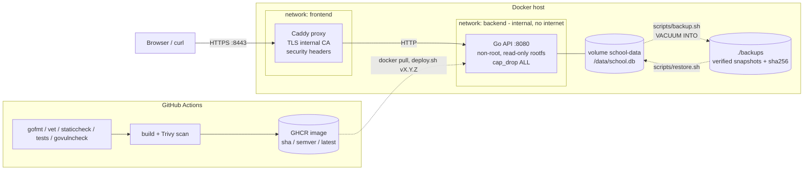
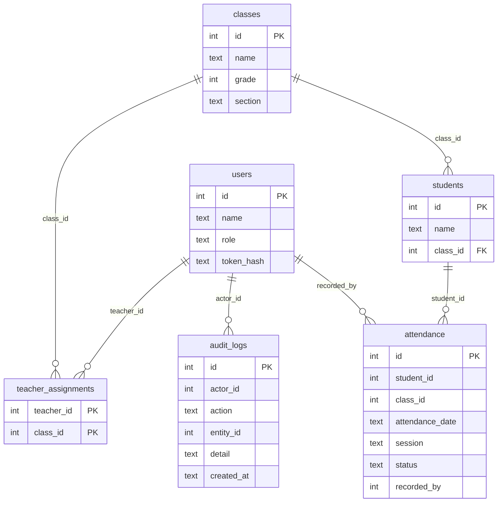

# Architecture

## Database schema

`attendance` has `UNIQUE(student_id, class_id, attendance_date, session)` and `CHECK` constraints on
`status` (`PRESENT`, `ABSENT`) and `session` (`MORNING`, `AFTERNOON`).

## Security design

- Only the proxy is published; the API sits on an `internal` network with no route to the internet.
- API container: non-root (uid 65532), distroless image, read-only root filesystem, all capabilities dropped, `no-new-privileges`.
- Proxy: all capabilities dropped except `NET_BIND_SERVICE`; HSTS and other security headers; Caddy admin API disabled.
- Tokens are hashed (SHA-256) at rest; authorization (role + class assignment) is enforced server side, and the actor id always comes from the authenticated token, never the request body.
- Configuration is via environment variables; no secrets are committed (`.env` is ignored).
- CI uses least-privilege permissions (`contents: read`; `packages: write` only in the publish job).
